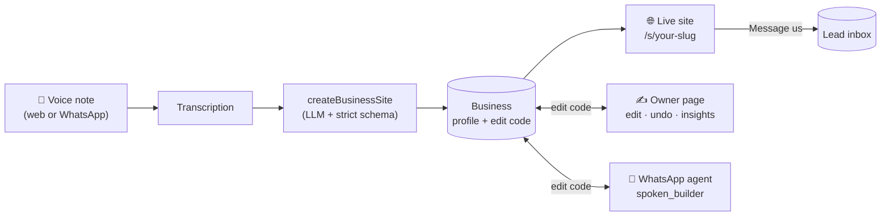
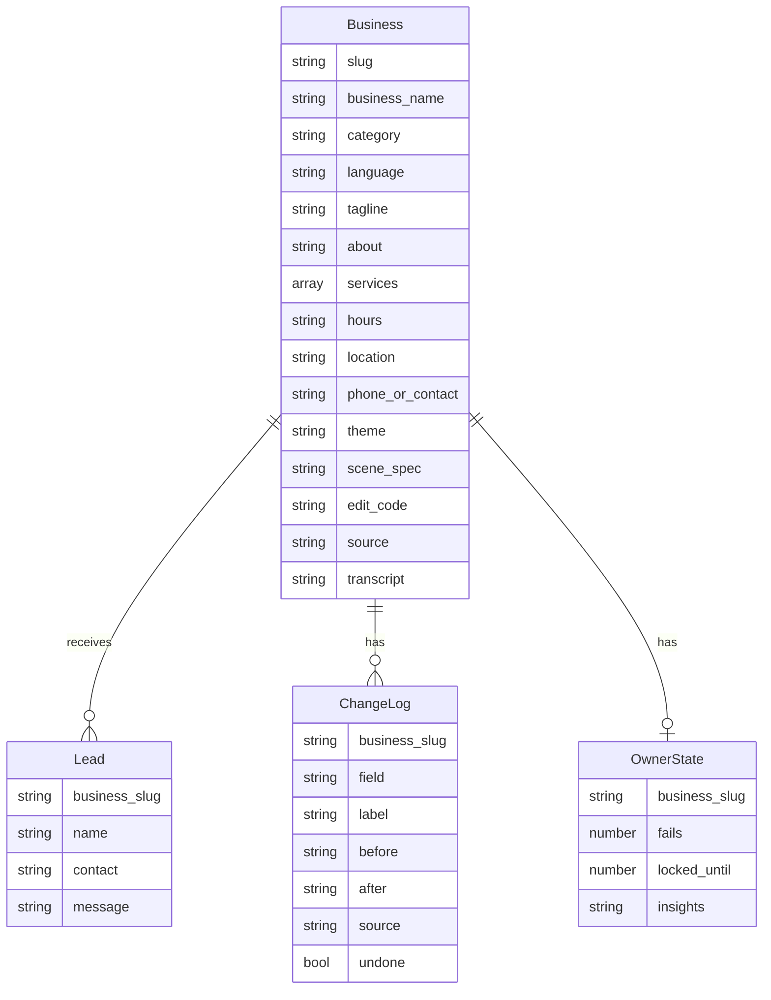

<div align="center">

# 🎙️ Spoken

### Say it, and it's live.

**Record one voice note about your business. Get a real, designed website, in about a minute.**
Then change anything on it by sending a text.

[**Live demo →**](https://groovy-speak-build-grow.base44.app) &nbsp;·&nbsp; [Owner page demo](https://groovy-speak-build-grow.base44.app/home/owner.html) &nbsp;·&nbsp; [How it works](#how-it-works) &nbsp;·&nbsp; [Security](#security-and-trust-by-design)


</div>

---

## The idea

Most small businesses (a bakery, a bike repair stall, a dog groomer) don't have a website. Not because they don't want one, but because the tools ask for too much: templates, forms, logos, copywriting, hosting.

They do have one thing already: **they can talk about their business.**

Spoken turns that into a website.

> *"Hi, I'm Rosa. I run Rosa's Bakery on Maple Street. Butter croissants are three fifty, sourdough loaves are seven dollars. We're open Monday to Saturday, six to two."*

That sentence becomes a finished page: name, tagline, price list, hours, location, a hero scene drawn from what you actually said, and a message form that sends customer enquiries straight to you. No typing, no templates, no account.

## What you get

| | |
|---|---|
| 🎤 **Voice to website** | Speak for 20–60 seconds in the browser, or send a WhatsApp voice note. Any of 7 languages. |
| 🎨 **Five designs, picked for the business** | Craft, Minimal, Zine, Bold and Editorial themes. The AI picks one that fits, with its own colours and a hero scene made from objects you mentioned. |
| ✍️ **Edit by text** | Send "change croissants to four dollars" on WhatsApp, or use the owner page. Guarded by a 6-character edit code. |
| 🛡️ **Only what was said** | The AI is not allowed to invent prices, claims or services. If you didn't say a price, it says *Ask us*. |
| 📬 **A customer inbox** | The "Message us" form on every site lands in a private owner page. |
| 🧠 **Weekly summary with one-tap fixes** | The owner page reads recent messages, explains what customers keep asking for, and suggests small changes you can apply in one tap. |
| ↩️ **Undo, always** | Every change is logged with before and after values. The last one can be undone in a tap. |

## How it works



1. **Capture.** The browser records audio (or WhatsApp delivers it). The `transcribeVoiceNote` function returns plain text.
2. **Understand.** `createBusinessSite` sends the transcript to an LLM with a strict JSON schema: business name, category, language, tagline, services with prices, hours, location, contact, theme and a *scene spec* (archetype, set piece, up to 5 illustrated objects, a 3-colour palette, mood, and an optional kicker line quoted from your own words).
3. **Validate.** Nothing from the model is trusted as-is. Every field is clipped to length, enums are checked, object IDs must exist in the illustration library, colours must be valid hex, and a kicker is dropped unless it appears word for word in the transcript.
4. **Publish.** A unique slug is generated, a random edit code is created, and the Business record is saved. The site is live at `/s/<slug>` immediately.
5. **Maintain.** The owner opens the owner page (or texts the WhatsApp agent) with the edit code to change the site, read messages and undo mistakes.

### The hero scene

The scene on each site is not a stock photo. It is composed from a library of illustrated objects (a loaf, a wrench, a vinyl record, a teapot…) using a handful of layouts (`hearth`, `counter`, `workbench`, `studio`, `desk`, `street`), a mood (`dawn`, `day`, `dusk`, `night`) and the three-colour palette. A bakery looks warm and floury. A night-time record shop looks like one.

## Security and trust by design

Spoken has no passwords and no accounts, so the edit code is the key. Everything around it is built to make that safe.

- **One door.** The owner page talks to a single backend function, `ownerAccess`. It checks the code first, then reads or changes *only* that site.
- **Constant-time comparison.** Edit codes are compared without early exit, so response timing can't leak a correct prefix.
- **Brute-force lock.** 5 wrong codes lock that site for 15 minutes (tracked in `OwnerState`). The public demo site is exempt.
- **Codes never leave the server.** `ownerAccess` returns a public view of the business with the edit code removed. The WhatsApp agent shows a code exactly once, right after creating the site, and refuses after 3 wrong attempts in a conversation.
- **Allow-listed changes.** Edits and AI suggestions must match a fixed set of actions (`add_service`, `edit_service_price`, `set_hours`, `set_tagline`, plus theme and contact for the owner). Anything else is rejected.
- **No invented facts.** Suggested prices are forced to *Ask us* unless the owner already stated that exact price. Suggested hours may only restate what is there.
- **Full audit trail.** Every change is stored in `ChangeLog` with `before` and `after` JSON, its source (`owner_page`, WhatsApp), and an undone flag.
- **Row-level security.** `Business` can be read publicly but only updated or deleted by admins; `OwnerState` is admin-only. All owner writes go through the service role inside `ownerAccess`.
- **Rate limiting.** Site creation from the web is capped at 40 per hour to protect the model budget.

## Data model



## Tech stack

| Layer | Tools |
|---|---|
| Front end | React, Vite, Tailwind CSS, shadcn/ui |
| Marketing page | Hand-written HTML with GSAP + ScrollTrigger + Lenis; a WebGL fragment shader blends 500+ pre-rendered frames into a scroll-driven film |
| Backend | Base44 serverless functions (Deno, TypeScript) |
| Data | Base44 entities with row-level security |
| AI | LLM calls with JSON-schema output (profile extraction, owner insights), speech-to-text |
| Messaging | WhatsApp agent (`spoken_builder`) with tool access to the same functions |

## Repository layout

```
base44/
  agents/spoken_builder.jsonc     WhatsApp agent: new-site flow, edits, refusals, privacy rules
  entities/                       Business, Lead, ChangeLog, OwnerState (with RLS)
  functions/
    createBusinessSite/           transcript -> validated profile -> live site + edit code
    ownerAccess/                  the single guarded door for the owner page
    transcribeVoiceNote/          audio URL -> text
    siteStats/                    public counters for the landing page
  config.jsonc                    app configuration
```

## Try it

- **Make a site:** open the [live app](https://groovy-speak-build-grow.base44.app), allow the microphone and say a few sentences about any business.
- **See the owner side:** open the [owner page](https://groovy-speak-build-grow.base44.app/home/owner.html) and use the demo site `rosa-demo` with code `DEMO42`. The demo resets every time it opens.

## Design notes

- **Voice first, but never voice only.** Every voice path has a text path.
- **Small, reversible edits.** Spoken only ever changes one field at a time, shows exactly what changed, and keeps the old value.
- **Say less, claim less.** A site that says *Ask us* is better than one that confidently says something false.

## Author

Built by **Abhinav Awasthi**.

---

<div align="center">

*Say it, and it's live.*

</div>
